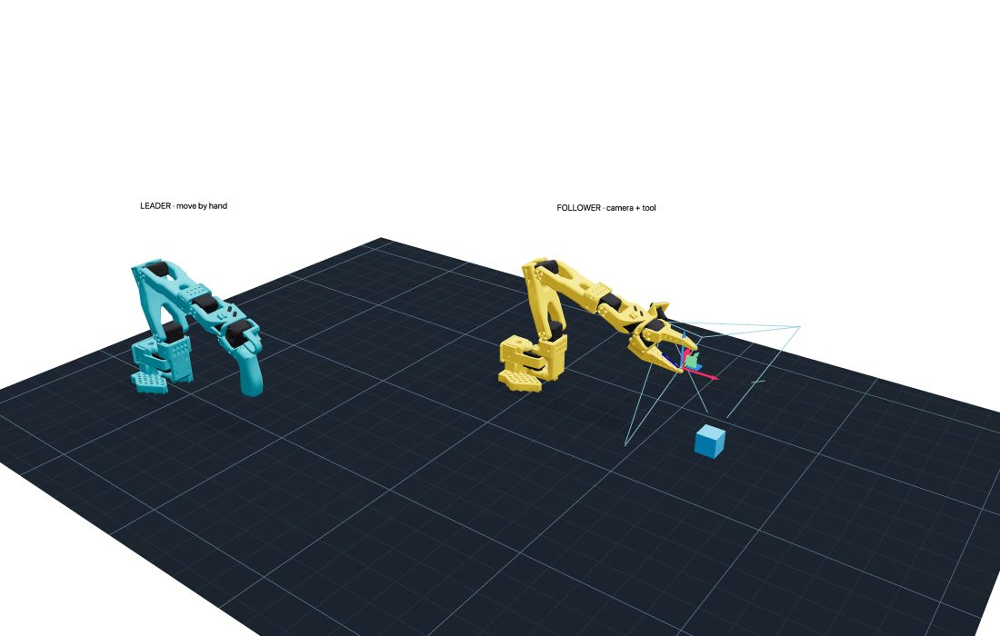

# SO-101 camera and interchangeable-tool workbench

This fork adds a local simulation workspace for a Bambu Lab A1 mini build. It
uses the upstream SO-101 models and printable geometry at commit
`a758567c3978dfeefe282ede0500085a48fe8f78`. Upstream CAD, STLs and robot descriptions
remain unchanged.



The **leader** is the arm you move by hand. The **follower** is the powered arm
that copies it and eventually runs a learned policy. Both are SO-101 designs.
The older SO-100 assets are retained in this repository, but this workbench runs
the SO-101 pair.

## Start

Install [uv](https://docs.astral.sh/uv/getting-started/installation/) if needed.
From the repository directory:

```sh
uv sync --python 3.12
uv run python Simulation/Workbench/app.py
```

Open **http://127.0.0.1:8080**. On this Mac you can also double-click
`Start Workbench.command`. The server binds only to this computer. Stop it with
Ctrl-C in its terminal. The UI bundles its own assets; no hosting account is needed.

## Try it

1. Click **Run motion demo**. The teal leader shows the input; the yellow
   follower follows through position actuators with gravity, inertia, command
   slew, joint limits and torque saturation. The leader itself is a kinematic
   input, not a model of the human operator's forces.
2. Move individual joints, or drag the target handle and click **Solve target +
   move**. IK solves position only, then samples 41 poses along the direct joint
   path to reject intersections. It is not a motion planner or a guarantee of
   collision-free motion between samples. Manual sliders intentionally allow
   contact experiments.
3. In **Vision & tools**, select the stock gripper, spatula concept or whisk
   concept and apply. Compare motor load as you increase tip payload or an
   externally applied downward test force. This force is an idealized applied
   wrench, not a simulation of food resistance.
4. Watch the simulated wrist and overhead RGB cameras. Wrist optics are placed
   just beyond the upstream camera housing, with assumed FOV and zero lens
   distortion. Calibrate physical intrinsics and extrinsics after camera selection.
5. **Record → Start recording**, operate the arm, then stop. Use **Save pose +
   camera snapshot** for individual experiments.

The six joints are five arm axes plus a jaw/trigger. There are **not six
independent arm pose axes**. A long tool needs task-specific orientation planning;
the position-only reach helper cannot establish spatula angle or whisk alignment.

## Demonstration files

Each episode in `Simulation/Workbench/runs/` contains:

- `metadata.json`: model revision, configuration, units, nominal capture rate,
  resolution and explicit simulation/calibration flags.
- `frames.jsonl`: simulation timestamps, leader input, target and actual follower
  angles, velocities, actuator forces, TCP, robot contacts, and camera poses and
  intrinsics for each captured frame.
- `wrist_rgb/*.png` and `overhead/*.png` (only overhead when wrist camera is off).

Capture occurs approximately every 0.1 simulation seconds; use the recorded
timestamps, rather than assuming exact wall-clock timing. Physics can run slower
than real time on a busy machine. Recording pauses with physics. All images and
joint state in one frame use the same simulation state. Recordings are ignored by
Git and never uploaded automatically.

This is an inspectable experiment format, **not a LeRobot training dataset**.
This version does not connect to servos, record physical cameras, train a policy,
or deploy one. The real workflow is demonstrated by the official
[LeRobot imitation-learning guide](https://huggingface.co/docs/lerobot/il_robots):
teleoperate → collect aligned images/actions → train → evaluate. We will implement
that bridge after the camera/tool interface is settled.

## What the model assumes

- Stock link geometry, mass and inertia come from upstream. Its motor dynamics
  are approximate. This fork sets experimental position gains to kp=80 and
  kv=2.7, uses implicit integration at 500 Hz, and slews commands at 45°/s.
- The 1.60 Nm default ceiling approximates the upstream 16.5 kg·cm stall figure
  at 6V. It is not a continuous operating rating or a measured servo model.
  The upstream XML uses 3.35 Nm, which is not used as the default here.
- Camera and mount add the upstream 15 g + 20 g. Tool concepts add 70 g
  (spatula) or 65 g (whisk), before an optional test payload.
- Tools are assumed rigidly attached to the stock gripper frame. This does not
  simulate retention, slippage or a working quick-change mechanism. The stock
  jaw remains present. No custom tool holder is approved for printing yet.
- Mesh collisions use convex hulls. This can close real cavities and distort
  gripper contacts. The small fixed base uses an approximate box; the adjacent
  base/shoulder pair is excluded because the proxy overlaps at the joint.
  Other links still collide with the proxy. Cable collisions are absent.
- Trigger travel is provisional in the upstream leader model. The leader's
  trigger is mapped by normalized range to follower jaw travel. This is not
  the calibrated LeRobot 0–100 gripper convention.
- No flexible parts, liquids, cooking, heat, material stress, cable loads,
  electronics, motor temperature or food-contact validation are modeled.

## Change and verify

`Simulation/Workbench/engine.py` contains model construction, physics, contacts
and IK. `app.py` contains the UI, rendering and recording. Adjust camera/tool
concepts here without overwriting upstream files. Actual mechanical changes must
also update STEP/STL geometry, collision geometry, mass, inertia, TCP and vision
frames; a visual-only change does not validate a printable modification.

```sh
uv sync --group dev --python 3.12
uv run pytest -q
uv run python Simulation/Workbench/prepare_prints.py
```

See [BUILD_PLAN.md](BUILD_PLAN.md) for the A1 mini package and the next design
decisions. See [VALIDATION.md](VALIDATION.md) for this version's measured checks.
